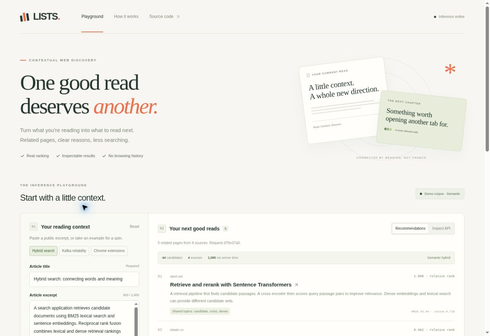
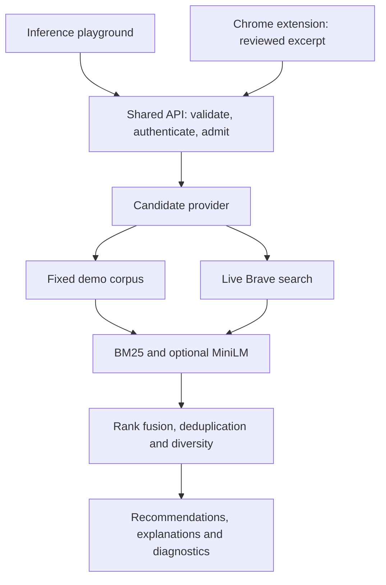

<p align="center"></p>

<p align="center">
  <a href="#quick-start">Quick start</a> ·
  <a href="#inference-playground">Playground</a> ·
  <a href="docs/HLD.md">Architecture</a> ·
  <a href="docs/VERCEL_DEPLOYMENT.md">Deploy to Vercel</a>
</p>

<p align="center"><a href="https://github.com/deepak2233/lists-semantic-discovery/actions/workflows/ci.yml"></a></p>

**Find your next useful read from the article you are reading.** LISTS turns a reviewed title and excerpt into related-page recommendations, with shared-topic explanations and inspectable ranking scores.

Use the Chrome extension in your reading workflow, or use the inference playground to cross-check the same Python pipeline. The server executes the ranking. The interface does not fabricate recommendations or silently replace failed web searches with fixtures.

> **Project status:** tested reference implementation with explicit deployment and release boundaries. This is a modern implementation of the LISTS brief, not recovered historical source or evidence of production usage since 2017.

## What you can do

| Capability | Behavior |
| --- | --- |
| Contextual recommendations | Up to ten related pages from a reviewed public excerpt |
| Real semantic inference | Pinned MiniLM ONNX embeddings on CPU, fused with BM25 and diversified |
| Cross-check ranking | Switch between automatic, lexical baseline and semantic hybrid modes |
| Inspect the evidence | View actual BM25/cosine scores, relative fused rank, stage timings and API JSON |
| Review before sharing | Browser extraction stays local until the user chooses to send |
| Handle failures clearly | Explicit validation, auth, quota, empty-result, timeout and dependency-error states |
| Deploy one application | FastAPI entrypoint plus a responsive, dependency-free frontend on Vercel |

## Inference playground

The webpage provides authored sample contexts, editable input, ranking controls, relevance explanations and a request/response inspector. It uses the same extraction helpers and API as the extension.



**Candidate source and ranking model are separate settings.** The default hosted demonstration performs real inference over 44 authored technical-resource descriptions. It is labeled **Demo corpus**. Live web discovery requires a configured search-provider subscription and protected API access.

The interface always reports the active mode. Semantic mode is rejected with `409` if the server has no model; it never silently becomes lexical mode. Result scores are relative to that request, not relevance probabilities.

## Quick start

Python 3.12 is the tested deployment runtime. Use [uv](https://docs.astral.sh/uv/getting-started/installation/), Node.js 22+ for development tests, and Chrome 114+ for the extension.

```bash
git clone https://github.com/deepak2233/lists-semantic-discovery.git
cd lists-semantic-discovery
uv sync --frozen --extra dev --extra semantic
npm ci
npm run build
uv run --no-sync python scripts/download_model.py
uv run --no-sync python scripts/dev_web.py --port 8000
```

Open **http://127.0.0.1:8000**. The model setup explicitly downloads approximately 90 MB of pinned ONNX weights and verifies the publisher checksum. The service never downloads weights during a recommendation request.

For a lightweight lexical-only run, omit `--extra semantic` and the model-download command. Keep `models/minilm` absent or explicitly configure a reviewed model path when you want semantic inference.

### Chrome extension

1. Open `chrome://extensions`, enable Developer mode, then choose **Load unpacked** and select `extension/`.
2. Open a public English article and click LISTS.
3. Select **Preview this page**, review or edit the excerpt, then select **Find related pages**.

The default backend is `http://127.0.0.1:8000`. Configure a deployed HTTPS backend in the extension settings and grant only that host. Incognito, browser-internal pages, local addresses and obvious account pages are excluded. These heuristics are not a complete sensitive-content detector.

### API-only service

```bash
uv run --no-sync uvicorn lists_api.main:app --host 127.0.0.1 --port 8000 --no-access-log --no-proxy-headers
```

Development API docs: `/docs`. Capability metadata: `/v1/config`. Health checks: `/health/live` and `/health/ready`.

A `.env` file is not automatically loaded by the Python application. Set process environment variables directly, or use Docker Compose with `.env.example` copied to `.env`.

## How the system fits together



| Stage | Choice | Reason |
| --- | --- | --- |
| Page context | Local, deterministic extraction | Bounded input and a reviewable sharing decision |
| Candidate recall | Search provider or explicit fixed corpus | A ranker cannot discover URLs outside its candidate pool |
| Relevance | BM25 plus optional MiniLM cosine similarity | Compare lexical and semantic evidence |
| Fusion | Reciprocal rank fusion | Avoid adding incompatible raw score scales |
| Diversity | MMR-style redundancy penalty and two results per exact host | Reduce repetition without inventing filler |
| Model runtime | Local, checksum-verified ONNX artifacts | CPU inference without a hosted embedding API or GPU dependency |

See the [full HLD](docs/HLD.md), [research notes](docs/RESEARCH.md) and [decision records](docs/ADR.md). The research covers Sentence-BERT, TextRank, RRF, MMR, BEIR and HNSW. These references inform design choices; they do not prove this application's relevance or scale.

## Deploy to Vercel

The root `app.py` is the FastAPI entrypoint. `vercel.json` configures a 30-second request limit and response security headers. `scripts/build_vercel.py` builds shared frontend assets, installs only the locked runtime graph into an isolated deployment directory, and prepares the pinned model before publication.

Import this repository into your Vercel account with the **FastAPI** framework and repository root as the project root. The default web application is a fixed-corpus demonstration, so it cannot spend a search-provider quota. Set `LISTS_BUILD_SEMANTIC=0` only if you intentionally want a lexical-only deployment.

See [Vercel deployment instructions](docs/VERCEL_DEPLOYMENT.md) for exact configuration, smoke checks, rollback and the boundary between a public demo and a protected live service.

## Live web search

A protected live deployment uses a server-side [Brave Search API](https://api-dashboard.search.brave.com/app/documentation/web-search/get-started) credential. Do not put this credential in the extension, browser JavaScript, repository or issue tracker.

The adapter requests at most two pages of 20 candidates under a total deadline. Confirm that your subscription permits the burst. A provider failure produces a clear `503`. The provider receives a derived title/topic query, not the full reviewed excerpt or source URL.

Use `LISTS_ENV=production`, `LISTS_PROVIDER=brave`, `LISTS_AUTH_MODE=jwt`, trusted identity settings and exact allowed website/extension origins. A public demonstration cannot enable the paid provider. See [operations](docs/OPERATIONS.md).

## Verify the implementation

```bash
npm run build
uv run --no-sync pytest
npm test
uv run --no-sync ruff check .
uv run --no-sync ruff format --check .
uv run --no-sync python scripts/evaluate.py
uv run --no-sync python scripts/verify_http.py
uv run --no-sync python scripts/verify_http.py --model-path models/minilm
```

The suite covers backend contracts and browser logic, including malformed payloads, signed URLs, duplicate handling, JWT failures, provider outages, quotas, cache expiry, cancellation, stale responses, unsafe links and JSON inspection.

**No test suite establishes that all corner cases are covered.** Independent relevance evaluation, actual Chrome extension acceptance, global quota enforcement and production load/failover tests remain separate requirements. The small authored relevance set and loopback probes are explicitly not production benchmarks.

## Project layout

| Path | Responsibility |
| --- | --- |
| `public/` | Responsive inference playground and static assets |
| `app.py` | Same-origin FastAPI deployment entrypoint |
| `extension/` | Installable Manifest V3 extension |
| `backend/lists_api/` | API, providers, ranking, ONNX inference and controls |
| `tests/` | Backend regressions, extension checks and playground interaction tests |
| `deploy/` | Frozen runtime dependency export for Vercel builds |
| `evaluation/` | Authored contexts, relevance judgments and recorded results |
| `scripts/` | Development, build, evaluation, HTTP verification and report generation |

## Production boundary

This repository provides a working system and a reviewable path to production. It does not establish enterprise certification or production-scale performance. Public release still requires managed end-user sign-in, provider contractual review, independent relevance judgments, centralized admission/budget controls, operational monitoring and measured staging behavior.

Process-local rate limits and caches are not distributed controls. Vercel can run multiple instances; their state is not shared. The public demo uses a fixed corpus and no paid search calls. For a live multi-user service, enforce account-wide quotas and spend limits at a shared gateway before expansion.

Read [CONTRIBUTING.md](CONTRIBUTING.md), [SECURITY.md](SECURITY.md) and [NOTICE.md](NOTICE.md) before making changes. Source is MIT licensed; the model and external services retain their own terms.
