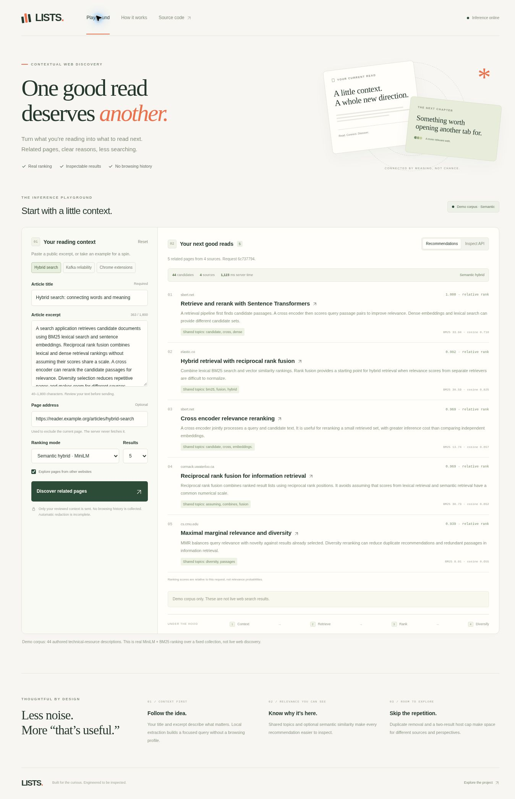

# Data sources, model provenance and training status

Verified on 14 November 2026. The deployed application is an inference and retrieval implementation. No model has been trained or fine-tuned specifically for this repository.

## What this project actually uses

| Component | Actual source | Purpose | Training performed here |
| --- | --- | --- | --- |
| Embedding model | [sentence-transformers/all-MiniLM-L6-v2](https://huggingface.co/sentence-transformers/all-MiniLM-L6-v2) | Encode reviewed text and candidate descriptions | None; reuse published weights |
| Hosted demo candidates | [demo_corpus.json](../backend/lists_api/data/demo_corpus.json) | 44 descriptions authored for this project, pointing to technical resources | None; these are inference candidates |
| Authored relevance fixtures | [queries.json](../evaluation/queries.json) | Eight contexts with relevance judgments over those same 44 descriptions | None; regression checks only |
| Live candidate retrieval | [BraveProvider](../backend/lists_api/retrieval.py) | Retrieve web-search candidates when explicitly configured | No trained model in the adapter; hosted demo does not enable it |
| BM25, rank fusion and diversity | [ranking.py](../backend/lists_api/ranking.py) | Score and order the retrieved candidates | Deterministic algorithms; no fitted learning-to-rank model |

The demonstration descriptions were not scraped from a public training dataset. Their destination URLs point to real resources, but their snippets and labels were authored together. They are not an independent benchmark, representative browsing data or evidence of production recommendation quality.

No MS MARCO or BEIR dataset has been downloaded or used to train or independently evaluate this implementation. Referencing those sources in research notes does not establish that a training or evaluation run occurred.

## The reused model's upstream training

The [publisher's pinned model card](https://huggingface.co/sentence-transformers/all-MiniLM-L6-v2/blob/1110a243fdf4706b3f48f1d95db1a4f5529b4d41/README.md) attributes approximately 1.17 billion training tuples to a mixture including Reddit, S2ORC, WikiAnswers, PAQ, Stack Exchange and MS MARCO, among other datasets.

Its authors fine-tuned a pretrained MiniLM encoder using contrastive learning: cosine scores distinguish matched sentences from other sentences within the batch, optimized with cross-entropy. They report AdamW, a 0.00002 learning rate, 100,000 updates, batches of 1,024, 500 warmup steps and a 128-token training limit. These are the publisher's reported settings, not experiments reproduced for LISTS.

The model card labels the model Apache-2.0. That model license does not establish a uniform license for every underlying dataset.

The application pins revision `1110a243fdf4706b3f48f1d95db1a4f5529b4d41`. The ONNX weights must match SHA-256 `6fd5d72fe4589f189f8ebc006442dbb529bb7ce38f8082112682524616046452`. Both download and runtime loading verify the artifacts.

## What happens during inference

1. The user reviews a title and excerpt. The extension extracts that context locally. The webpage requires the user to provide it; entering a URL alone does not download the article.
2. The selected provider supplies candidate descriptions. Demo mode always supplies the fixed authored collection; live mode calls the configured search provider.
3. BM25 computes lexical scores. The frozen MiniLM encoder produces 384-dimensional vectors using attention-mask mean pooling and L2 normalization. Inference is capped at 256 tokens and runs on CPU through ONNX Runtime.
4. Reciprocal rank fusion combines the available rankings. A diversity step and duplicate filters select up to ten pages.

Weights are not updated during requests. There is no personalization model, feedback training loop, fitted cross-encoder or custom learning-to-rank training job in this version.

## Why the demo cannot satisfy arbitrary web discovery

The ranker can only return pages supplied by its candidate provider. A topic outside the 44 technical descriptions can receive weak matches or fewer useful results. A larger training dataset would not make unindexed or newly published web pages available to this provider.

For the original live-web use case, enable candidate discovery using the implemented Brave adapter with server-side credentials and the protected production configuration in [VERCEL_DEPLOYMENT.md](VERCEL_DEPLOYMENT.md). Alternatively, build and maintain an authorized document index. That alternative is described in the HLD but is not implemented here.

The hosted fixed-corpus demo is not a completed general-web recommendation product. A working demonstration and passing software tests do not remove that limitation.

## Data for a future training or evaluation experiment

These are possible next experiments, not completed work:

- [MS MARCO](https://microsoft.github.io/msmarco/) provides search relevance data. Its published terms restrict it to non-commercial research, so it must not be presented as an unrestricted commercial training source.
- [BEIR](https://github.com/beir-cellar/beir) provides heterogeneous retrieval evaluation collections. Check each collection's terms and keep evaluation topics outside training and tuning.
- For article-to-related-page relevance, collect authorized source articles, candidate pages and independent usefulness judgments. Query-to-answer passage labels do not directly validate this particular use case.

A defensible fine-tuning experiment would split by article and topic, mine hard negatives, train a contrastive bi-encoder on positive pairs, and compare it with the frozen baseline on a held-out set. Report NDCG@10, recall, coverage and duplicate rates. Such an experiment has not been run or claimed in this repository.

## Observed hosted verification

Deployment `dpl_8FAFYwq7FeGaEAeg8aJqfGdvgXeR` serves code commit `d0580c3c993831b081f001c1f95a794c8deba64e` at [the inference webpage](https://lists-semantic-discovery.vercel.app/). Actual browser interactions verified:

| Input and mode | Observed result |
| --- | --- |
| Hybrid search, automatic | 10 recommendations, 8 hosts, real cosine scores |
| Kafka reliability, automatic | 10 recommendations, 10 hosts, real cosine scores |
| Chrome extensions, automatic | 10 recommendations, 9 hosts, real cosine scores |
| Chrome extensions, lexical | 5 recommendations, lexical ranker, no cosine scores |
| API inspector | Actual request and server response visible |

The deployment fixes declare inference libraries in the packaged runtime graph and include the shared JavaScript assets in source. The browser retains same-origin deployment sessions. The repair commit passed 92 Python tests, 36 Node tests and a clean production-environment web check in [GitHub CI](https://github.com/deepak2233/lists-semantic-discovery/actions/runs/43398071202).

This screenshot shows actual hosted semantic inference over the authored collection. It is not evidence of live web retrieval or new model training.

