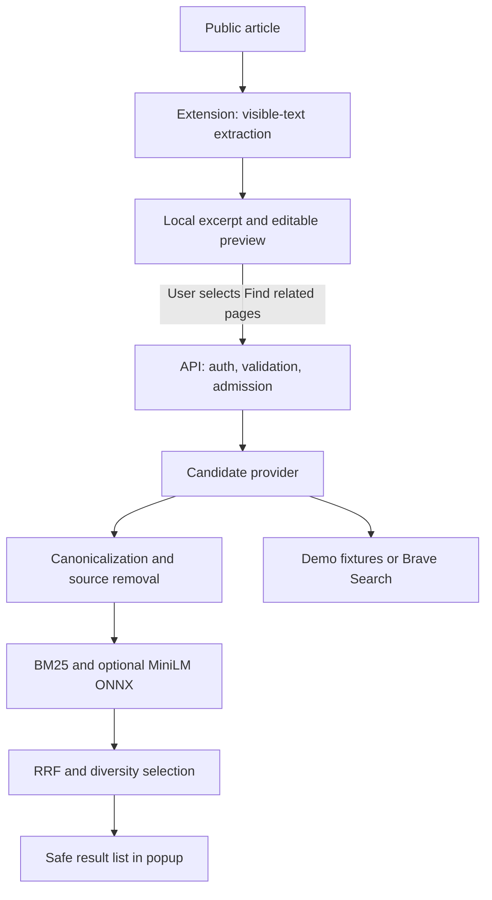
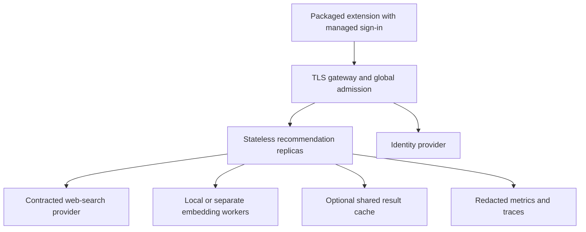

# LISTS high-level design

Version 1.0 | 12 November 2026 | Owner: Deepak Yadav

## 1. Decision summary

LISTS is a contextual related-page recommender. It uses the current article as a temporary query context. The first implementation uses a licensed web-search provider for candidate discovery, followed by local relevance ranking. It does not attempt to crawl and index the entire web.

The critical distinction is between **finding candidates** and **ranking candidates**. A summarizer alone cannot discover new URLs. A vector model alone cannot retrieve pages that were never indexed or returned by a provider. A good architecture makes both boundaries explicit.

Start with one deployable API and one extension. Add infrastructure when measured load or product requirements justify it. A Kafka cluster, Kubernetes deployment and vector database are not prerequisites for reranking forty snippets.

## 2. Product definition and use cases

The core user is a researcher, engineer, student or reader who wants useful next reading without composing a new search query.

| Current page | Desired recommendations | Failure to avoid |
| --- | --- | --- |
| Hybrid search engineering article | Rank fusion paper, embeddings guide, reranking tutorial | Ten pages that merely repeat the same article |
| Kafka delivery semantics | Idempotent consumer, transactions, downstream duplicate handling | Generic Kafka marketing pages |
| Manifest V3 tutorial | Narrow permissions, storage, network rules, official examples | Unrelated Chrome product news |
| Python API deployment | ASGI workers, upstream timeouts, overload controls | Another page from the exact same source only |

Recommendations concern individual pages. Website-level similarity requires a separate domain representation and site aggregation policy. It is a potential extension, not an interchangeable claim.

The original brief says automatic recommendations. Here, ranking is automatic **after a user action**. Continuous background collection changes the permission and privacy model, so it requires a separate product decision and explicit consent.

## 3. Scope and requirements

Functional requirements:

1. Read visible article text after an explicit extension action.
2. Produce a bounded English excerpt and topic words on the user's device.
3. Show exactly what will be shared; allow edits before transmission.
4. Retrieve up to forty provider candidates and return up to ten useful pages.
5. Exclude the source, canonical duplicates, unsafe URLs and excessive same-host results.
6. Show related-topic explanations and clear demo/live/lexical/semantic status.
7. Handle empty pages, restricted pages, expired identity, quota limits and upstream failure.

The result count is **at most ten**. Returning fewer results is correct when relevance or diversity filters remove candidates. Filling empty slots with unrelated links to satisfy a number is a product defect.

The first release supports public English text articles. It does not bypass paywalls, read browser-internal pages, use browsing history, personalize across sessions, interpret image-only pages or index user-submitted content.

Proposed nonfunctional targets are pilot hypotheses, not achieved measurements:

| Attribute | Pilot target | Validation |
| --- | --- | --- |
| Backend availability | 99.5% successful eligible requests per 30 days | Include provider failures; exclude invalid/auth/quota client requests |
| Live latency | p95 under 5 seconds at agreed load | Measure HTTP end to end with real provider and CPU model |
| Provider waiting | Hard total deadline of 3 seconds by default | Fault injection and live metrics |
| Request body | At most 16 KiB | Declared and chunked-body tests |
| Context size | Title <=300 chars, summary <=1800 chars | Typed request validation |
| Candidate work | Provider <=40; ranker defensive cap 100 | Provider contract tests |
| Retention | No durable source context in baseline | Log review and storage inspection |
| Relevance | Establish baseline before choosing numeric rollout thresholds | Independently judged held-out dataset |

## 4. Current executable architecture



All browser code is packaged locally. This extension does not need a background service worker because no persistent background activity is required. Closing the popup can end its in-flight request. That is acceptable for this interaction and is documented instead of relying on long-lived extension globals.

| Component | Responsibility | Implemented location |
| --- | --- | --- |
| Extractor | Read visible paragraphs/headings; skip forms/navigation | `extension/extractor.js` |
| Local NLP | Frequency-based keywords and sentence selection; obvious identifier redaction | `extension/nlp.js` |
| Preview | User edits, destination disclosure, explicit send | `extension/popup.js` |
| API boundary | Validation, origin/host checks, JWT, request IDs, admission | `backend/lists_api/main.py` |
| Provider | Fixed Brave endpoint or explicit authored fixtures | `backend/lists_api/retrieval.py` |
| Ranker | BM25, optional dense score, rank fusion, diversity | `backend/lists_api/ranking.py` |
| Semantic runtime | Local MiniLM tokenization, ONNX, masked mean pooling | `backend/lists_api/semantic.py` |
| Controls | Process-local bounded rate windows and optional cache | `backend/lists_api/controls.py` |

## 5. Detailed request journey

1. The user opens a public article and invokes LISTS. `activeTab` permits temporary access. No content script is permanently attached to every website.
2. The extractor inspects at most 500 candidate DOM nodes and collects at most 30,000 characters. It skips hidden elements, navigation, forms and editable regions. Obvious password or editable pages are refused.
3. A deterministic extractor produces up to four useful sentences, capped at 1,200 characters, plus up to ten topic words. It does not generate factual claims. The UI presents the resulting excerpt.
4. The user edits the preview and selects the recommendation action. Keywords are recalculated from the edited text so deleted private terms do not survive in an older keyword list.
5. The extension rechecks that the source tab still has the same cleaned URL. Query strings and fragments are removed from the source address. This reduces exposure but is not a proof that the remaining path contains no personal information.
6. The API validates a strict schema. Unexpected fields are rejected. A raw-body limit applies before JSON parsing. Validation errors identify fields without echoing the submitted content.
7. In a protected deployment, JWT verification checks RS256 signatures, issuer, audience, expiration, issued-at, subject and the required scope. The trusted JWKS location comes from deployment configuration, never from the request.
8. A per-subject limit and bounded concurrency protect the service. Cache entries, if enabled, are isolated by subject and expire within five minutes. Caching is off by default pending provider terms review.
9. The query builder uses sanitized title/topic words. The live provider makes up to two sequential requests for 20 web results each under one deadline. It requests strict provider safe search. It performs no arbitrary page fetches.
10. The ranker drops unsafe links, the current page, exact canonical duplicates, near-identical titles and optionally the exact source host. Remaining results receive lexical and optional dense scores.
11. Rank fusion combines orderings. Diversity selection chooses at most ten results, capped at two per exact host. The UI renders text nodes and safe links, with short shared-topic explanations.
12. The response carries a new request ID, mode, ranker version, candidate count, elapsed time and warnings. Application logs contain status and request ID only.

## 6. NLP and ranking design

### 6.1 Local extraction

The implemented summarizer is a frequency-based extractive baseline. Sentence score is the sum of log-scaled topic counts divided by the square root of sentence term count. It selects four sentences, then restores document order. This is simple, deterministic and cheap. It is **not TextRank**, an abstractive summarizer or a trained intent model.

Known weaknesses are boilerplate, sentence splitting around abbreviations and loss of key information outside selected sentences. A future evaluated variant can use TextRank or a small local model. Neither is necessary before obtaining a relevance baseline.

### 6.2 Candidate recall

The live candidate pool comes from a search provider's index. Its query relevance, index coverage, freshness and plan restrictions place an upper bound on LISTS quality. Reranking cannot recover a relevant page absent from that pool.

The authored demo corpus deliberately avoids network calls. It is useful for installation and regression checks, not evidence of broad web coverage. Its original short summaries are fixtures, not copied provider snippets.

### 6.3 BM25

BM25 scores title/snippet terms against the source context. Title text is repeated to provide a simple title boost. Term frequencies and document frequencies are computed over the bounded candidate set, not over a globally indexed corpus. That makes this a local reranking baseline rather than a web-scale BM25 engine.

With k1=1.2 and b=0.75, each query term contributes its inverse-document-frequency weight times a saturating, document-length-normalized term frequency. Zero lexical overlap is excluded when the semantic model is absent. This will miss synonyms and paraphrases with no shared terms.

### 6.4 Dense similarity

The optional `all-MiniLM-L6-v2` model maps short English text to 384 dimensions. The implementation uses the publisher's pinned ONNX export, an explicit 256-token cap, attention-mask mean pooling and L2 normalization. It runs on CPU with bounded ONNX thread settings. It does not download weights during API startup.

The query prioritizes the title and the first bounded part of the reviewed excerpt. This introduces truncation bias. A later experiment should compare sentence-chunk max/mean pooling against this baseline. Candidate snippets may describe a page incompletely; this system does not verify their full contents.

Dense cosine >=0.25 allows a zero-overlap candidate into the pool. That is an initial tuning parameter, **not a calibrated relevance threshold**. Validate it with domain-specific judgments before launch.

### 6.5 Rank fusion

For candidate d, `RRF(d) = sum(1 / (60 + rank_i(d)))`. The fused order includes BM25, provider rank in live mode, and dense similarity when enabled. Demo insertion order is excluded because it is arbitrary.

Rank fusion avoids adding incomparable raw scales. It still does not guarantee an improvement: measure against provider-only, BM25-only and dense-only baselines. The response's score divides by the best fused score in that request; it cannot be compared across queries.

### 6.6 Duplicate control and diversity

Canonicalization removes fragments/tracking parameters and normalizes host/scheme formatting. Identity comparison treats www and trailing slash variants as equivalent for duplicate detection. Nontracking query keys are retained for candidate URLs so meaningful links are not broken.

Selection uses `0.8 * normalized_fused_relevance - 0.2 * maximum_Jaccard_similarity_to_selected`. This is an MMR-style adaptation using lexical redundancy. It is not the original paper's exact experimental setup. Each exact host has a cap of two. Subdomains and independently hosted mirrors can still evade this cap; production domain grouping needs the public suffix list and a measured dedup strategy.

There is no LLM in this request path. An LLM adds cost and failure modes without being necessary for contextual URL recommendation. A cross encoder is a possible later relevance experiment on the final twenty candidates.

## 7. API and error contract

`POST /v1/recommend` accepts a JSON object:

```json
{
  "page_url": "https://reader.example.org/article/hybrid-search",
  "title": "Hybrid search and reranking",
  "summary": "A reviewed excerpt explaining how lexical search and sentence embeddings retrieve candidate documents.",
  "keywords": ["hybrid search", "embeddings", "reranking"],
  "language": "en",
  "limit": 10,
  "exclude_same_host": true
}
```

Response fields include request ID, `demo` or `live` mode, actual ranker name, results, warnings, candidate count, cache status and backend elapsed milliseconds. Each result has an opaque URL-derived ID, safe URL, title, snippet, host, explanation and request-local ranking score. The generated OpenAPI contract is available in development.

| Status | Meaning | Client action |
| --- | --- | --- |
| 200 | Completed, including an honest empty result set | Display results and warnings |
| 401 | Missing, invalid or expired access token | Renew the user's token |
| 403 | Browser origin is not allowed | Check approved extension configuration |
| 413 | Raw body exceeds 16 KiB | Reduce input |
| 422 | Unsupported or invalid request fields | Correct the preview |
| 429 | User request quota reached | Respect Retry-After |
| 503 | Provider unavailable or service admission full | Back off; do not silently use demo |

Unexpected internal failures remain server errors and must be monitored. A live gateway must replace generic error bodies without enabling verbose traceback output.

## 8. Data design and ownership

The running baseline has no application database. Source excerpts exist in popup memory and in API request memory. No browsing-history profile is created. The optional cache retains only result objects and warnings under an opaque per-process HMAC key derived from subject and request; it does not store the raw request object.

| Data | Location | Baseline retention |
| --- | --- | --- |
| Raw visible text | Extension memory | Current popup interaction |
| Reviewed excerpt/title | Popup and API memory | In-flight request |
| Backend origin | Browser local storage | Until changed/uninstalled |
| Short-lived user token | Browser session storage | Until cleared or browser session ends |
| Provider credential | Backend secret environment | Deployment secret lifecycle |
| Recommendation cache | API process memory, disabled by default | Configured TTL <=300 seconds |
| Operational status/request ID | Application logs | Deployment-defined; proposed 14 days |

Proxy, identity-provider, hosting and search-provider retention require separate review. The code cannot enforce a third party's retention policy. Automatic regex redaction is incomplete and is not an enterprise DLP control.

## 9. Capacity model and economics

Illustrative workload: 10,000 daily users, six recommendations per user, two provider requests per uncached recommendation, 30 days/month, tenfold peak factor.

| Quantity | Calculation | Result |
| --- | --- | --- |
| Recommendations/day | 10,000 x 6 | 60,000 |
| Average recommendation rate | 60,000 / 86,400 | 0.69 requests/s |
| Illustrative peak rate | 0.69 x 10 | 6.94 requests/s |
| Provider calls/day, no cache | 60,000 x 2 | 120,000 |
| Provider calls/month, no cache | 120,000 x 30 | 3,600,000 |
| Provider calls/month, 40% eligible cache hit | 3,600,000 x 0.6 | 2,160,000 |

If the contracted search cost is C per thousand requests, provider spend is `3,600 * C` per month without cache, excluding taxes, overages, compute and networking. This is a formula, not a quoted current price. A search plan's QPS ceiling may matter more than CPU capacity.

Little's law gives expected in-flight work as arrival rate times average service time. At 6.94 requests/s and an assumed 1.2-second mean, about 8.3 requests are active. A single process with eight admission slots has little headroom under that assumption. Benchmark first; then scale replicas, tune slots and enforce a global provider quota. The code's process-local user limits are not an account-wide quota across replicas.

No vector index is required for forty candidates. If an owned corpus is introduced, one million raw float32 embeddings at 384 dimensions consume 1.536 GB before identifiers, metadata and ANN overhead. Actual index sizing must be measured for the chosen engine and recall target.

## 10. Production evolution



Use two replicas across failure domains for the pilot when availability requires it. Offload per-account quotas and total provider spend controls to a gateway or shared control plane before enabling multiple replicas. Load a model once per process and account for its memory per replica.

An owned-corpus branch is justified only by measured coverage/cost needs and lawful content access. Its offline pipeline would be: approved URL sources, robots/terms checks, bounded fetching, extraction, language/quality filters, canonical dedup, content hash, chunking, versioned embeddings, index alias publication and deletion propagation. Store document ID, canonical URL, title, language, content hash, fetch time, license/policy status, model version and index version. Build a new index, validate it and atomically switch an alias; do not partially mix vector model versions.

That crawler/index pipeline is a target design, not implemented here. User excerpts must never be added to an owned index merely because a recommendation request was made. Kafka is justified only when durable independent ingestion consumers and replay are needed. A simple scheduled queue can precede it.

## 11. Reliability and failure handling

The live provider uses connection limits, request timeouts, a total deadline and a basic process-local breaker. After three failed calls, requests are stopped for thirty seconds. There are no automatic retries in the critical path, avoiding quota amplification. This is not a coordinated fleet-wide, single-probe half-open implementation.

If page extraction fails, show an actionable message and transmit nothing. If the provider fails, return 503. If a configured model cannot load, fail startup. If the service is full, reject quickly. If few candidates survive, return fewer. These behaviors preserve the meaning of the response.

The core service has simple status counters and request IDs. Pilot observability must add end-to-end latency histograms, provider-call latency/error/quota metrics, admission rejection counts, candidate/result-count distributions and model-version labels. Do not label by raw page URLs or users.

## 12. Tradeoffs and release gates

The largest unresolved risks are relevance recall, sensitive page content, provider economics, real-browser compatibility and managed identity. This repository provides a working engineering baseline and a reviewable route to address them. See the roadmap, operations and security documents for exact acceptance criteria. Calling it enterprise-ready before those checks would be unsupported.
